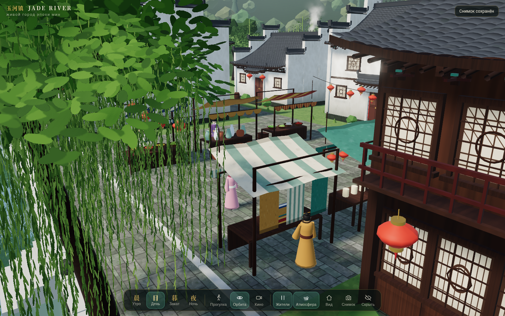
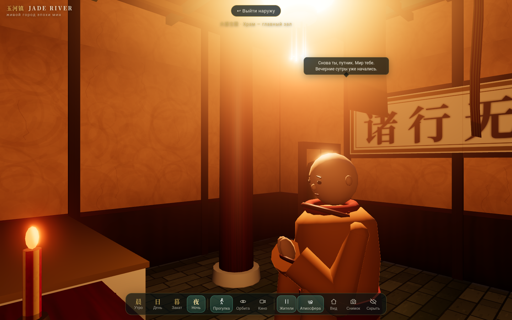
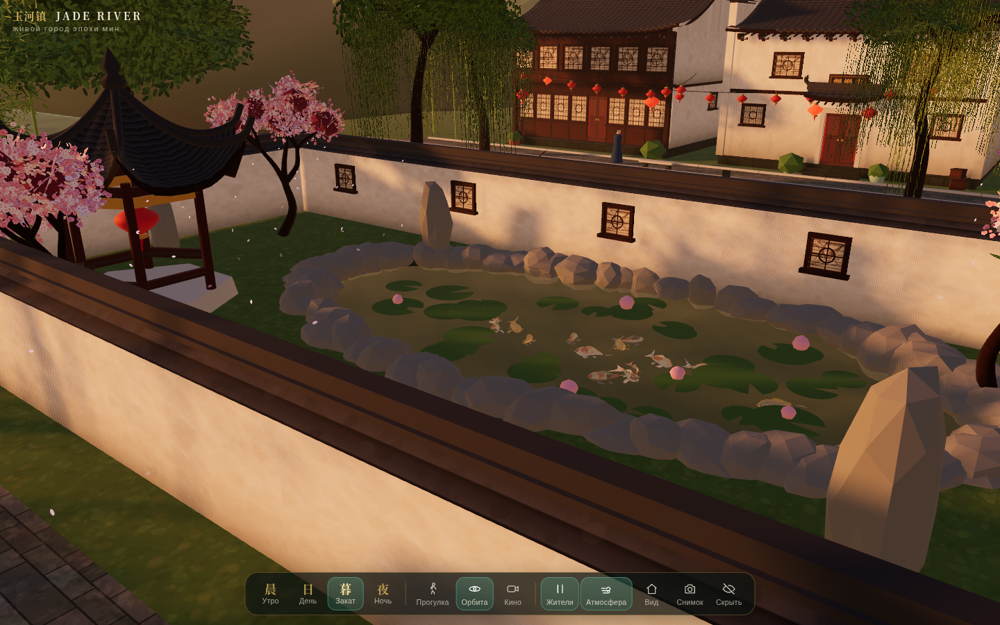

# 玉河镇 · JADE RIVER — живой китайский город

Интерактивная 3D-сцена: водный город Цзяннань эпохи Мин. По улицам можно ходить, заходить в дома, смотреть на канал и пруд с карпами, переключать утро, день, закат и ночь.

Сейчас актуальная версия — **4.2**. В ней закрыта дыра в полу второго этажа чайной у выхода на балкон и убрано мерцание стен чайной и дверей храма (листы дверей больше не лежат в одной плоскости с косяком). Версия 4.1 остаётся в истории ниже.

**Открыть город:** https://zxcarbuz.github.io/jade-river/

Это один самодостаточный HTML-файл (`docs/index.html` в ветке `main`). Ничего устанавливать не нужно: достаточно браузера с WebGL2.

В городе: канал с отражениями, два каменных моста, чайный дом, лапшичная, рынок, гостиница, храм с воротами-пайфан, сад с прудом кои, 20 домов и 21 житель (12 гуляют по улицам, 9 работают на местах: торговцы, повар, чайный мастер, хозяин гостиницы, монах). У каждого есть характер, дом и расписание по утру, дню, закату и ночи.

## Управление

Снизу экрана — панель кнопок.

**Камера**
- **Прогулка** — идти по городу от первого лица.
  - На компьютере: WASD или стрелки, Shift — быстрее, перетаскивание мышью — взгляд.
  - На телефоне: виртуальный джойстик слева внизу — идти, свайп справа — смотреть. Панель и джойстик работают и в альбомной ориентации (узкая нижняя полоса, учитываются вырезы безопасной зоны).
- **Орбита** — крутить вид снаружи: перетаскивание вращает, колесо или щипок — зум, правая кнопка мыши или два пальца — сдвиг.
- **Кино** — камера сама облетает город по маршруту. Чтобы остановить, нажми «Орбита».

Клавиши смены режима: G — прогулка, O — орбита, K — кино. Если в режиме орбиты нажать WASD, включится прогулка.

**Время суток:** Утро, День, Закат, Ночь (клавиши 1–4). По умолчанию город открывается на закате; в режиме заката время медленно идёт само.

**Другие кнопки**
- **Жители** (P) — остановить или снова отпустить жителей.
- **Атмосфера** (F) — включить или выключить эффекты (частицы, ветер, плотность тумана).
- **Вид** (R) — вернуться к стартовому ракурсу и закату. Клавиша R в режиме прогулки не срабатывает.
- **Снимок** (C) — сохранить картинку PNG.
- **Скрыть** (H) — убрать интерфейс; маленькая кнопка «глаз» возвращает его обратно.

Клик или тап по объекту или жителю показывает подпись. У входов в здания появляется кнопка **«Войти внутрь»**. Выйти можно кнопкой **«Выйти наружу»** или клавишей X.

**Параметры в адресе страницы** (можно сочетать, например `?q=low&t=day`):
- `?q=high`, `?q=medium` или `?q=low` — качество картинки. Если параметр не указан, на телефоне ставится `medium`, на компьютере — `high`.
- `?t=morning`, `?t=day`, `?t=sunset` или `?t=night` — сразу открыть выбранное время суток.

## Что можно посмотреть

- Пруд в саду: 14 карпов кои четырёх пород (Kohaku, Showa, Ogon, Sanke). Они плавают стайкой; клик по пруду их вспугивает.
- Внутрь можно зайти в пять мест: чайную «Нефритовый лист», лапшичную, один жилой дом, гостиницу и главный зал храма (大雄宝殿). Интерьеры подгружаются, когда входишь, а не сразу при открытии города.
- Во второй этаж и на балкон поднимаются лестницы в чайной и в гостинице.
- Если кадров не хватает, качество может само понизиться. На низком качестве дальние крыши заменяются упрощёнными формами (LOD).

## Жители

Двадцать один житель живёт по заранее прописанному дню, без нейросети и без сервера: решения считаются простыми правилами, поэтому на телефоне это почти ничего не добавляет.

- У каждого есть имя, роль, характер, дом и расписание на утро, день, закат и ночь.
- Днём рынок открыт, торговцы стоят у прилавков, остальные гуляют, сидят в чайной или лапшичной, заходят в храм или к пруду.
- Ночью рынок пустеет, люди расходятся по домам и больше не видны на улице. Монах Хуэй Мин остаётся в главном зале храма и читает сутры.
- Если подойти близко, житель здоровается короткой фразой (она зависит от времени суток и от того, встречались ли вы уже сегодня). По клику или тапу открывается карточка: имя, роль, чем он сейчас занят, и короткая мысль.
- Память у каждого — кольцо на 8 событий (увидел тебя, поздоровался, не смог занять место). Более старые записи вытесняются.

Это сознательно упрощённый вариант идей из [Generative Agents](https://github.com/joonspk-research/generative_agents): характер, день по часам и лёгкая память есть, а живого разговора через нейросеть нет.






## Снимки





## История версий

- **v1** (21 ноября 2026, коммит [`cfa1eda`](https://github.com/zxcarbuz/jade-river/commit/cfa1eda)) — первая версия: улицы, канал, мосты, дома, жители, смена времени суток, демо на GitHub Pages.
- **v2** ([PR #1](https://github.com/zxcarbuz/jade-river/pull/1), слит как [`c299f4c`](https://github.com/zxcarbuz/jade-river/commit/c299f4cd8e69355225dcf7217b05b4be9b76a958)) — можно заходить внутрь зданий, подробные кои, поэтапная детализация по расстоянию (LOD). Тогда проходило 66 из 66 проверок.
- **v3** ([PR #2](https://github.com/zxcarbuz/jade-river/pull/2), слит как [`6f1f2ae`](https://github.com/zxcarbuz/jade-river/commit/6f1f2aef669600717d9e31d8671df5cb5cc7242a)) — зал храма, вторые этажи и балконы чайной и гостиницы, правки камеры и обстановки. Тогда проходило 84 из 84 проверок.
- **v3.1** ([PR #3](https://github.com/zxcarbuz/jade-river/pull/3), слит как [`aa80bf6`](https://github.com/zxcarbuz/jade-river/commit/aa80bf6cbab81c5f503fd4057bf674bebd3156e1)) — правки по скринам с iPhone: вывески и столы без мерцания, объёмнее кроны, столбы навесов до земли, проход через лунные ворота к пруду, посуда и бочки стоят на опоре, ниже ступени, днища горшков закрыты, силуэт Будды и рукава монаха, швы мостовой. Тогда проходило 89 из 89 проверок.
- **v4** ([PR #5](https://github.com/zxcarbuz/jade-river/pull/5), слит как [`c28189d`](https://github.com/zxcarbuz/jade-river/commit/c28189d)) — у всех 21 жителя появились характер, дом и расписание по времени суток; ночью рынок пустеет, люди уходят домой, монах остаётся в храме; простая память на 8 событий, приветствия при приближении и мысль на карточке. Решения считаются по очереди, без нейросети. Тогда проходило 103 из 103 проверок.
- **v4.1** ([PR #6](https://github.com/zxcarbuz/jade-river/pull/6), слит как [`9c2b56a`](https://github.com/zxcarbuz/jade-river/commit/9c2b56a)) — правки по скринам с iPhone: балка и колонна больше не перекрывают проход на второй этаж чайной и галерею гостиницы; крыша аптеки и остальных домов закрыта у фронтонов; убрано мерцание под карнизами и на юбке между этажами; лёгкое сглаживание (MSAA 4× на high, SMAA на medium/low); руки монаха сложены в «гасшо», рукава свисают; альбомная ориентация на iPhone (компактная панель, джойстик, безопасная зона, FOV). Тогда проходило 117 из 117 проверок.
- **v4.2** — правки по скринам с iPhone: пол второго этажа чайной сплошной у фасадной стены и в дверном проёме на балкон (больше нет дыры вниз); листы дверей во всех интерьерах сдвинуты внутрь от косяка, панели штукатурки чуть отодвинуты от наружных стен — без мерцания на косяках храма и на стенах чайной. Последний записанный прогон тестов: 119 из 119, на компьютере и в эмуляции iPhone (портрет 390×844 и альбом 844×390), без ошибок в консоли.

## Как запустить у себя и прогнать тесты

Нужны Node.js и npm.

```bash
npm install
npm run dev       # локальный сервер разработки (Vite)
npm run build     # один файл dist/index.html
npm run preview   # посмотреть собранный файл
npm test          # e2e-проверки (node tests/e2e.mjs)
```

`npm test` запускает headless Chrome через playwright-core. Последний сохранённый отчёт — `shots/test-results.txt`: **119 PASS, 0 FAIL, ALL PASSED**, на обычном (desktop) прогоне и в мобильной эмуляции iPhone (портрет и альбом), без ошибок в консоли.

Живой сайт на GitHub Pages берётся из `docs/index.html` в ветке `main` (это копия собранного файла).

## Технические сведения

Стек: Three.js `^0.187.0`, Vite `^8.3.8`, `vite-plugin-singlefile` `^2.3.4`, тесты — `playwright-core` `^1.65.1`. Рендер — WebGL2.

Качество `high` / `medium` / `low` задаёт плотность пикселей, размер теней, свечение (bloom), как часто обновляется карта теней, дальность детализации, густоту леса и дальность отрисовки жителей. На `low` включаются упрощённые дальние прокси крыш. Если средний FPS падает ниже 32 на `high`, сцена переходит на `medium`; ниже 24 на `medium` — на `low`. Обратно поднимается только с `medium` на `high`, и только не на телефоне (средний FPS выше 58).

Числа ниже — сколько треугольников и вызовов отрисовки видно в кадре (все проходы: основной, тени и отражение), разрешение 1280×800, скрипт `tests/measure.mjs`, рендерер SwiftShader. Файл: `shots/tris-calls.json`, ключ `v4.1`.

| Вид      | high (треуг. / вызовы) | medium            | low               |
|----------|------------------------:|------------------:|------------------:|
| overview | 1 611 599 / 504         | 1 382 522 / 494   | 1 203 647 / 433   |
| street   | 1 557 478 / 450         | 1 387 953 / 439   | 1 197 368 / 375   |
| canal    | 1 661 394 / 488         | 1 510 677 / 451   | 1 174 430 / 343   |
| garden   | 1 386 242 / 297         | 1 277 177 / 293   | 1 169 484 / 249   |

По сравнению с v4 на низком качестве добавилось примерно 19 тыс. треугольников и 3 вызова (SMAA и чуть более подробные фронтоны/монах). На high число вызовов не изменилось (сглаживание по-прежнему MSAA 4×). Медианное время кадра `__jade.advance(1/30)` на том же SwiftShader: low street 3.9 мс против 4.7 мс в v4, medium street 4.9 мс против 5.2 мс. Это не замер на живом iPhone.

Таблица нагрузки выше — замер v4.1; в v4.2 менялись только сдвиги геометрии интерьеров, повторный прогон `tests/measure.mjs` не делался.

Версия, которую показывает сама сцена: `window.__jade.version === 4.2`.

## Что пока не сделано

- Во второй этаж можно подняться только в чайной и в гостинице. В жилом доме и в лапшичной второго этажа нет.
- Замеров скорости (FPS) на настоящем iPhone в репозитории нет. Мобильные проверки e2e идут в эмуляции Playwright со SwiftShader, это не живое устройство.
- Жители не ведут свободный разговор через нейросеть: фразы и мысли собраны заранее. Это сделано специально, чтобы город оставался одним HTML-файлом и не требовал ключей и сервера.
